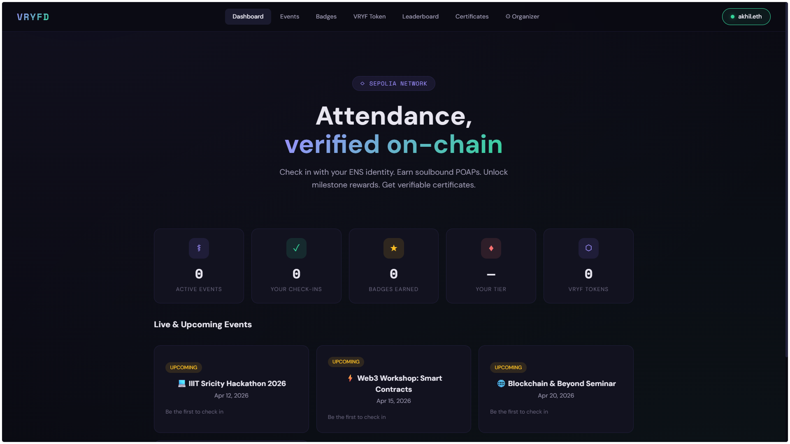
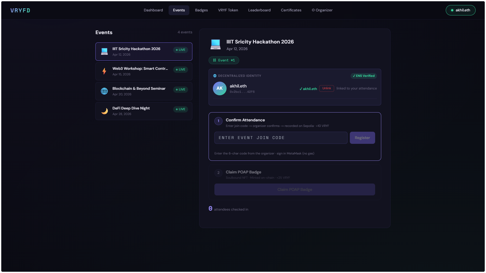
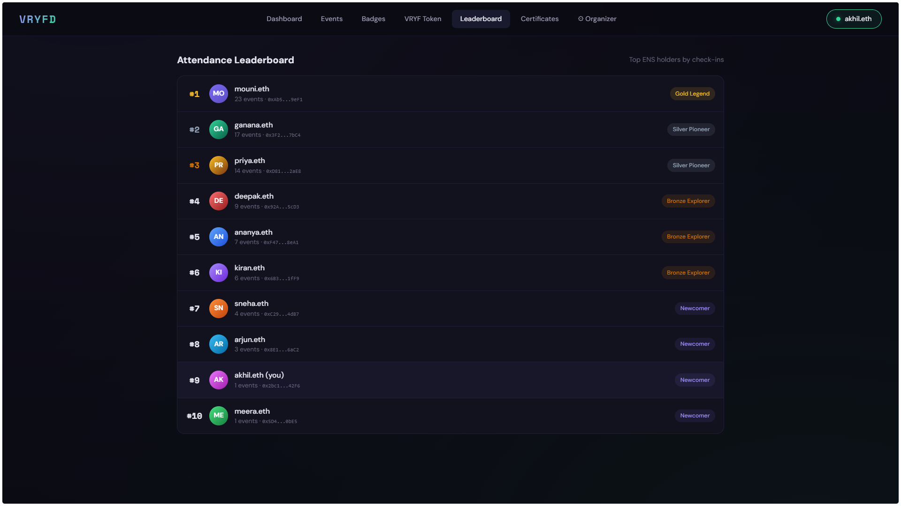
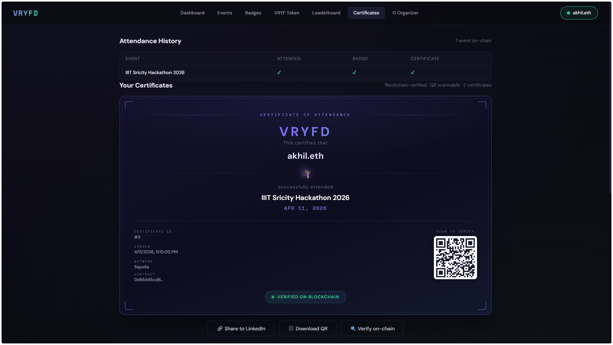

# VRYFD — Decentralized Attendance on the Blockchain

> Gasless check-ins. Soulbound badges. On-chain certificates. VRYF token rewards. All verified on **Ethereum Sepolia**.

**Live App:** [vryfd.online](https://vryfd.online)

---

## Screenshots

| Dashboard | Events |
|-----------|--------|
|  |  |

| Leaderboard | Certificates |
|-------------|-------------|
|  |  |

| VRYF Tokens |
|-------------|
|  |

---

## What is VRYFD?

VRYFD is a Web3 attendance platform where every check-in is recorded on-chain. Attendees sign in gaslessly using EIP-712 signatures — no gas fees ever. The backend relayer handles all on-chain transactions.

Attend events. Earn rewards. Build a verifiable on-chain attendance record.

---

## Features

### Gasless Check-In

Enter a 6-digit join code from the organizer, sign a message with your wallet (zero gas), and you're checked in on-chain. No ETH required from the attendee.

### POAP Badges

Earn a soulbound ERC-1155 NFT badge for every event you attend. Badges are non-transferable — proof that _you_ were there.

### VRYF Tokens

Earn ERC-20 VRYF tokens for every action:

| Action                       | Reward    |
| ---------------------------- | --------- |
| Check-in confirmed           | +10 VRYF  |
| POAP Badge claimed           | +25 VRYF  |
| Bronze milestone (5 events)  | +100 VRYF |
| Silver milestone (10 events) | +250 VRYF |
| Gold milestone (20 events)   | +500 VRYF |

### Milestone NFTs

Hit attendance milestones to unlock exclusive NFT badges — Bronze, Silver, and Gold tiers.

### Blockchain Certificates

Organizers issue tamper-proof attendance certificates on-chain. Each certificate has a unique QR code for instant public verification at any time.

### Leaderboard

See how you rank against other attendees. Supports ENS name resolution — your `.eth` name shows instead of a raw wallet address.

### Organizer Dashboard

Deploy events, generate join codes, confirm attendees, and issue certificates — all from a single dashboard.

---

## Tech Stack

| Layer           | Technology                                   |
| --------------- | -------------------------------------------- |
| Smart Contracts | Solidity, Hardhat, OpenZeppelin ERC-1155     |
| Frontend        | Next.js 14, TypeScript, wagmi v2, RainbowKit |
| Backend         | Node.js, Express, ethers.js v6               |
| Database        | MongoDB                                      |
| Storage         | IPFS via Pinata                              |
| Network         | Ethereum Sepolia Testnet                     |

---

## Live Deployment

| Service      | URL                                                                        |
| ------------ | -------------------------------------------------------------------------- |
| Frontend     | [vryfd.online](https://vryfd.online)                                       |
| Backend API  | [vryfd-production.up.railway.app](https://vryfd-production.up.railway.app) |
| Health Check | [/api/health](https://vryfd-production.up.railway.app/api/health)          |

---

## How It Works

```
Attendee connects wallet
        ↓
Enters 6-digit join code
        ↓
Signs EIP-712 message  ← zero gas cost
        ↓
Relayer submits on-chain tx  ← backend pays gas
        ↓
Organizer confirms attendance
        ↓
Attendee claims POAP Badge → earns VRYF tokens
        ↓
Milestone NFTs unlock at 5 / 10 / 20 events
        ↓
Organizer issues verifiable certificate with QR code
```

---

## Local Development

### Prerequisites

- Node.js 18+
- MetaMask browser extension
- Sepolia testnet ETH — [sepoliafaucet.com](https://sepoliafaucet.com)

### 1. Clone & Install

```bash
git clone https://github.com/akhilsabu-iiits/VRYFD.git
cd VRYFD
npm install
cd frontend && npm install
cd ../backend && npm install
```

### 2. Environment Setup

```bash
cp .env.example .env
# Fill in your values
```

Key variables:

```env
PRIVATE_KEY=                          # Relayer wallet private key (pays gas)
NEXT_PUBLIC_CONTRACT_ADDRESS=         # Deployed VryfdAttendance contract
ALCHEMY_API_KEY=                      # For RPC calls
MONGODB_URI=                          # MongoDB connection string
NEXT_PUBLIC_WALLETCONNECT_PROJECT_ID= # From cloud.walletconnect.com
NEXT_PUBLIC_BACKEND_URL=http://localhost:3001
```

### 3. Start Dev Servers

```bash
# Terminal 1 — Backend (port 3001)
cd backend && npm run dev

# Terminal 2 — Frontend (port 3000)
cd frontend && npm run dev
```

Open [http://localhost:3000](http://localhost:3000)

---

## Contract

**VryfdAttendance** — deployed on Ethereum Sepolia

| Function                 | Description                       |
| ------------------------ | --------------------------------- |
| `createEvent()`          | Deploy new event                  |
| `checkInFor()`           | Relayer submits check-in          |
| `claimBadge()`           | Mint soulbound POAP badge         |
| `claimMilestoneReward()` | Mint milestone NFT                |
| `issueCertificate()`     | Issue on-chain certificate        |
| `getAttendanceRecord()`  | Fetch wallet's attendance history |

---

## License

MIT
