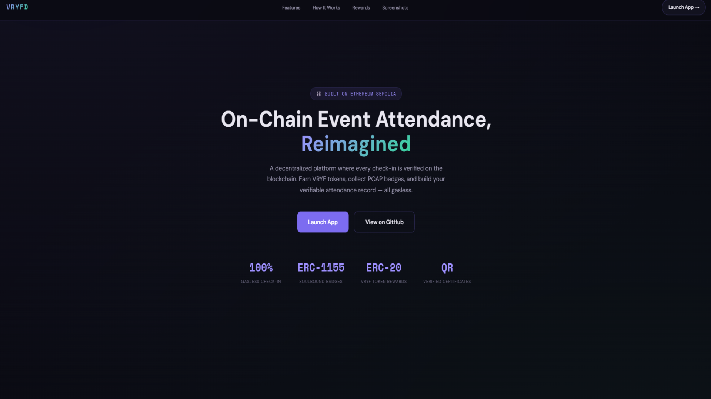
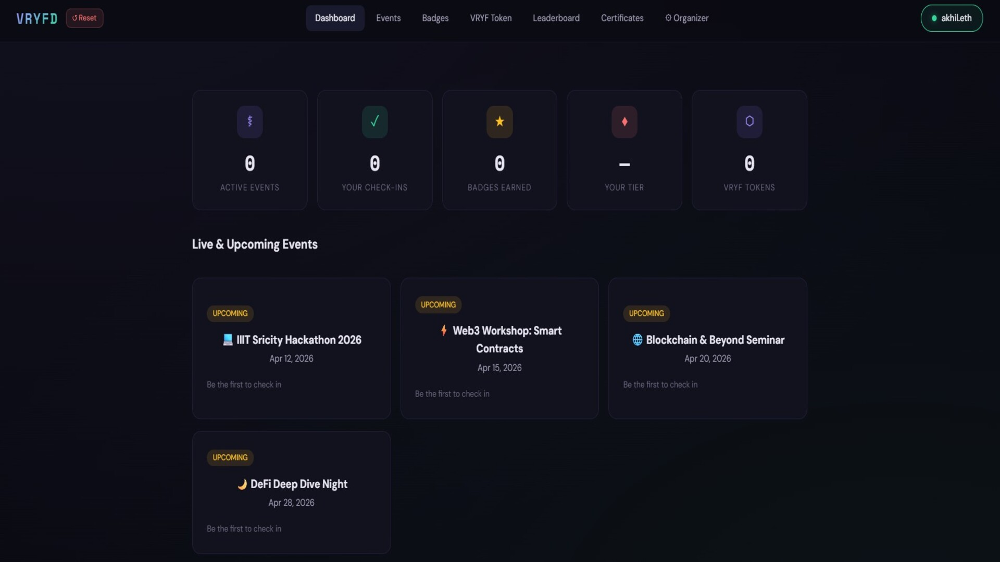

#  On-Chain Event Attendance System (VRYFD)

> A decentralized event attendance platform that enables participants to verify their attendance on-chain and earn VRYF tokens for verified participation.

---

## Screenshots

| Landing Page | Dashboard |
| --- | --- |
|  |  |

| Events | Leaderboard |
| --- | --- |
|  |  |

| VRYF Tokens | Certificates |
| --- | --- |
|  |  |

---

## Features

- **Gasless Check-In** — Sign with your wallet, zero gas fees. The relayer pays all on-chain costs.
- **POAP Badges** — Soulbound ERC-1155 NFT for every event attended. Non-transferable proof of presence.
- **VRYF Token Rewards** — Earn ERC-20 tokens for check-ins, badges, and milestone achievements.
- **Milestone NFTs** — Bronze, Silver, and Gold tier NFTs unlocked at 5, 10, and 20 events.
- **Blockchain Certificates** — Tamper-proof certificates with QR codes for instant public verification.
- **Leaderboard** — Ranked attendance board with ENS name resolution.
- **Organizer Dashboard** — Deploy events, generate join codes, confirm attendees, issue certificates.
- **Tamper-Proof Records** — Every check-in lives on-chain. No central authority can alter it.

---

## VRYF Token Rewards

| Action | Reward |
| --- | --- |
| Check-in confirmed | +10 VRYF |
| POAP Badge claimed | +25 VRYF |
| Bronze milestone (5 events) | +100 VRYF |
| Silver milestone (10 events) | +250 VRYF |
| Gold milestone (20 events) | +500 VRYF |

---

## How It Works

```
Attendee connects wallet
        |
Selects an event
        |
Enters 6-digit join code
        |
Signs EIP-712 message  <-- zero gas cost
        |
Relayer submits on-chain tx  <-- backend pays gas
        |
Organizer confirms attendance
        |
Attendee claims POAP Badge --> earns VRYF tokens
        |
Milestone NFTs unlock at 5 / 10 / 20 events
        |
Organizer issues verifiable certificate with QR code
```

---

## Tech Stack

| Layer | Technology |
| --- | --- |
| Smart Contracts | Solidity, Hardhat, OpenZeppelin ERC-1155 |
| Frontend | Next.js 14, TypeScript, wagmi v2, RainbowKit |
| Backend | Node.js, Express, ethers.js v6 |
| Database | MongoDB |
| Storage | IPFS via Pinata |
| Network | Ethereum Sepolia Testnet |
| Wallet | MetaMask, WalletConnect |

---

## Local Development

### Prerequisites

- Node.js 18+
- MetaMask browser extension
- Sepolia testnet ETH — [sepoliafaucet.com](https://sepoliafaucet.com)

### Setup

```bash
git clone https://github.com/akhilsabu-iiits/VRYFD.git
cd VRYFD
npm install
cd frontend && npm install
cd ../backend && npm install
```

```bash
cp .env.example .env
```

```env
PRIVATE_KEY=                          # Relayer wallet private key
NEXT_PUBLIC_CONTRACT_ADDRESS=         # Deployed contract address
ALCHEMY_API_KEY=                      # RPC provider
MONGODB_URI=                          # MongoDB connection string
NEXT_PUBLIC_WALLETCONNECT_PROJECT_ID= # WalletConnect project ID
NEXT_PUBLIC_BACKEND_URL=http://localhost:3001
```

### Run

```bash
# Terminal 1 — Backend
cd backend && npm run dev

# Terminal 2 — Frontend
cd frontend && npm run dev
```

Open [http://localhost:3000](http://localhost:3000)

---

## Documentation

[High-Level Documentation](docs/VRYFD_High_Level_Documentation.pdf) — Architecture, features, workflows, security model, and design patterns

---

## License

MIT
